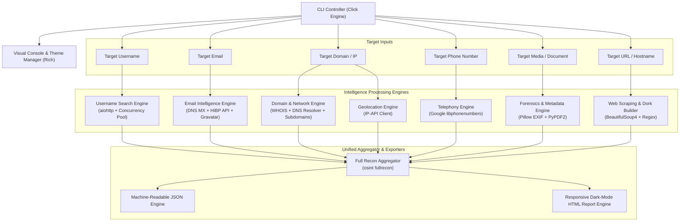

# OSINT Recon — Technical Documentation & Operational Report

[](https://www.python.org/)
[](https://github.com/pallets/click)
[](LICENSE)
[](#system-architecture)

**OSINT Recon** is a modular, high-performance Open Source Intelligence (OSINT) and digital footprinting framework implemented in Python. Designed for security analysts, penetration testers, forensic investigators, and intelligence researchers, it unifies identity attribution, network reconnaissance, telephone forensics, document metadata analysis, passive search indexing, and automated report generation into an intuitive command-line interface.

---

## Table of Contents

- [1. Executive Summary](#1-executive-summary)
- [2. System Architecture](#2-system-architecture)
  - [2.1 Component Flow Diagram](#21-component-flow-diagram)
  - [2.2 Core Design Principles](#22-core-design-principles)
- [3. Intelligence Modules & Technical Breakdown](#3-intelligence-modules--technical-breakdown)
  - [3.1 Username Attribution (`osint username`)](#31-username-attribution-osint-username)
  - [3.2 Email Intelligence & Breach Auditing (`osint email`)](#32-email-intelligence--breach-auditing-osint-email)
  - [3.3 Network & Domain Reconnaissance (`osint domain`)](#33-network--domain-reconnaissance-osint-domain)
  - [3.4 Telephony Forensics (`osint phone`)](#34-telephony-forensics-osint-phone)
  - [3.5 Document & Media Metadata Analysis (`osint metadata`)](#35-document--media-metadata-analysis-osint-metadata)
  - [3.6 Search Engine Dorking Engine (`osint dorks`)](#36-search-engine-dorking-engine-osint-dorks)
  - [3.7 Web Surface Harvester (`osint scrape`)](#37-web-surface-harvester-osint-scrape)
  - [3.8 Geolocation & IP Mapping (`osint geolocate`)](#38-geolocation--ip-mapping-osint-geolocate)
  - [3.9 Unified Orchestration & Full Recon (`osint fullrecon`)](#39-unified-orchestration--full-recon-osint-fullrecon)
- [4. Installation & Environment Configuration](#4-installation--environment-configuration)
  - [4.1 Prerequisites](#41-prerequisites)
  - [4.2 Production Installation](#42-production-installation)
  - [4.3 Windows Terminal Configuration](#43-windows-terminal-configuration)
  - [4.4 API Key Configuration](#44-api-key-configuration)
- [5. Complete CLI Command Reference](#5-complete-cli-command-reference)
- [6. Python Library / Programmatic API](#6-python-library--programmatic-api)
- [7. Reporting & Data Export Formats](#7-reporting--data-export-formats)
  - [7.1 Structured JSON Output](#71-structured-json-output)
  - [7.2 Responsive HTML Executive Dashboard](#72-responsive-html-executive-dashboard)
- [8. Threat Model, Ethics & Legal Framework](#8-threat-model-ethics--legal-framework)
- [9. Directory Layout](#9-directory-layout)
- [10. Troubleshooting & FAQ](#10-troubleshooting--faq)

---

## 1. Executive Summary

Digital footprinting and Open Source Intelligence gathering are frequently fragmented across disparate single-purpose tools, online web services, and fragile scripts. **OSINT Recon** consolidates essential intelligence-gathering pipelines into a unified offline/online toolkit:

1. **Identity & Handle Attribution:** Asynchronous query engines capable of scanning 50+ global platforms across social media, development hubs, creative networks, and gaming systems concurrently in seconds.
2. **Entity Validation:** Automated RFC 5322 syntax validation, DNS MX verification, provider fingerprinting, disposable email detection, and Gravatar discovery.
3. **Attack Surface & Infrastructure Discovery:** WHOIS registry auditing, multi-record DNS enumeration (A, AAAA, MX, NS, TXT, CNAME, SOA, SRV, CAA), dictionary-based subdomain discovery, HTTP banner inspection, server stack identification, and security header evaluations.
4. **Forensics & Telephony:** E.164 and RFC 3966 phone formatting, carrier resolution, geographic location attribution, EXIF parsing, GPS decimal conversion, and PDF metadata extraction.
5. **Passive & Active Intelligence:** Google Dork matrix generation (27 pre-calibrated security templates) and target URL scraping for email, phone, and framework extraction.
6. **Multi-Format Intelligence Delivery:** Console visualization via ANSI tables, structured machine-readable JSON exports, and standalone styled HTML reports.

---

## 2. System Architecture

### 2.1 Component Flow Diagram



### 2.2 Core Design Principles

- **Non-Destructive & Passive-First:** Operations favor passive lookup, standard DNS queries, public registry indices, and standard HTTP requests without intrusive probing or payload delivery.
- **Asynchronous Concurrency:** High-volume HTTP queries (such as cross-platform handle lookups) leverage Python's `asyncio` and `aiohttp` with managed worker semaphores to prevent connection exhaustion and socket throttling.
- **Graceful Degradation:** External API rate-limits, missing optional tokens (e.g., Have I Been Pwned keys), or socket timeouts are captured as structured exceptions rather than unhandled crashes.
- **Zero Third-Party Daemon Overhead:** Runs purely as a lightweight local CLI without requiring Docker containers, database engines, or background background daemons.

---

## 3. Intelligence Modules & Technical Breakdown

### 3.1 Username Attribution (`osint username`)

- **Implementation:** `osint_recon/username_search.py`
- **Methodology:** Asynchronously queries endpoints for 52 pre-configured public web platforms across social media, development, gaming, creative, and professional communities.
- **Concurrency Control:** Configurable `asyncio.Semaphore` (default: 20 concurrent tasks) using custom HTTP client sessions with standard Chrome desktop user agents.
- **False-Positive Mitigation:** Implements multi-tier detection:
  1. HTTP status code validation against the expected profile response code (typically 200).
  2. Sub-50KB DOM body string inspection searching for known "soft-404" signals (e.g., *"page not found"*, *"user not found"*, *"account doesn't exist"*, *"nothing here"*).

#### Covered Platforms by Category

| Category | Platforms Checked |
|---|---|
| **Social & Communities** | GitHub, Twitter/X, Instagram, Reddit, TikTok, Pinterest, Tumblr, Medium, Dev.to, LinkedIn, Threads, Bluesky, Mastodon, Telegram, Substack, Hashnode |
| **Developer & Tech** | GitLab, Bitbucket, HackerRank, LeetCode, Codewars, Stack Overflow, npm, PyPI, Docker Hub, Replit, Kaggle, HuggingFace |
| **Creative & Media** | Dribbble, Behance, DeviantArt, SoundCloud, Spotify, Vimeo, 500px, Flickr, YouTube |
| **Gaming & Hobbies** | Steam Community, Twitch, Roblox, Chess.com |
| **Professional & Funding** | Crunchbase, AngelList, Product Hunt, Hacker News, Keybase, About.me, Gravatar, Patreon, Ko-fi, BuyMeACoffee, Linktree |

```bash
# Example execution:
osint username dev_hunter --concurrency 25 --json-out hunters.json
```

---

### 3.2 Email Intelligence & Breach Auditing (`osint email`)

- **Implementation:** `osint_recon/email_recon.py`
- **Techniques Executed:**
  - **Syntax & Schema Verification:** Strict RFC 5322 regex validation.
  - **Domain & Mail Server Audit:** DNS resolution of Mail Exchange (`MX`) records using `dnspython` to confirm domain mail routing capability.
  - **Provider Identification:** Maps the host domain against known enterprise and consumer email providers (Google Workspace, Microsoft 365, ProtonMail, Tutanota, Fastmail, Zoho, etc.).
  - **Disposable / Burner Email Detection:** Cross-checks the target domain against a built-in dictionary of over 30 temporary and disposable inbox providers (e.g., Mailinator, GuerrillaMail, 10MinuteMail, Yopmail).
  - **Gravatar Identity Correlation:** Computes MD5 hash (`MD5(lowercase(trimmed(email)))`) and queries the Gravatar public avatar endpoint to confirm avatar presence and extract the associated profile URL.
  - **Breach History (Have I Been Pwned API v3):** If an API key is provided via `--hibp-key` or `HIBP_API_KEY`, queries the HIBP service for compromised accounts, compiling breach names, dates, leaked data classes, and total pwn counts.

```bash
# Example execution:
osint email target.analyst@proton.me
```

---

### 3.3 Network & Domain Reconnaissance (`osint domain`)

- **Implementation:** `osint_recon/domain_recon.py`
- **Dual-Mode Operation:** Automatically detects whether the input is an IPv4/IPv6 address or a Fully Qualified Domain Name (FQDN).
- **Sub-Analysis Components:**
  - **WHOIS Registry Analysis:** Queries public registries using `python-whois` to extract registrar details, creation/updated/expiration timestamps, nameservers, registrant organizations, and DNSSEC status.
  - **Comprehensive DNS Audit:** Queries 9 standard resource record types:
    - `A` & `AAAA` (IPv4 / IPv6 addresses)
    - `MX` (Mail exchangers)
    - `NS` (Authoritative nameservers)
    - `TXT` (SPF, DMARC, DKIM, and domain verification tokens)
    - `CNAME` (Canonical aliases)
    - `SOA` (Start of Authority)
    - `SRV` (Service locators)
    - `CAA` (Certificate Authority Authorization)
  - **Subdomain Brute-Forcing:** Performs local DNS resolution sweeps against 65 high-value subdomain prefixes (`api`, `dev`, `staging`, `vpn`, `portal`, `admin`, `k8s`, `s3`, `db`, `jenkins`, `grafana`, etc.).
  - **HTTP Banner & Stack Fingerprinting:** Issues HTTPS and HTTP requests to extract server banners (`Server`, `X-Powered-By`), content management systems (WordPress, Drupal), and generator tags.
  - **Security Header Posture Check:** Evaluates defense-in-depth security headers:
    - `Strict-Transport-Security` (HSTS)
    - `Content-Security-Policy` (CSP)
    - `X-Frame-Options`
    - `X-Content-Type-Options`
    - `X-XSS-Protection`
    - `Referrer-Policy`
    - `Permissions-Policy`

```bash
# Example execution (with fast flag skipping brute-force):
osint domain target-infrastructure.com --skip-subdomains
```

---

### 3.4 Telephony Forensics (`osint phone`)

- **Implementation:** `osint_recon/phone_lookup.py`
- **Underlying Engine:** Python port of Google's `libphonenumbers`.
- **Extracted Attributes:**
  - **Validation & Possibility:** Validates against the international numbering plan and checks mathematical plausibility.
  - **Standardized Representations:** Produces International, National, E.164 (`+<country><number>`), and RFC 3966 (`tel:+...`) formats.
  - **Geographic Attribution:** Decodes Country and regional sub-division (e.g., city, state, or metropolitan area).
  - **Carrier & Network Resolution:** Identifies telecom carrier names when registered in mobile database allocations.
  - **Line Classification:** Categorizes numbers into Mobile, Fixed Line, Fixed-or-Mobile, Toll-Free, VoIP, Premium Rate, Shared Cost, Pager, or Universal Access (UAN).
  - **Timezone Correlation:** Maps dialing codes to international IANA timezones.

```bash
# Example execution:
osint phone "+44 20 7946 0958" --region GB
```

---

### 3.5 Document & Media Metadata Analysis (`osint metadata`)

- **Implementation:** `osint_recon/metadata_extract.py`
- **Supported Formats:**
  - **Raster Images:** JPEG, PNG, TIFF, WebP, GIF, BMP, HEIC, Camera RAW (`.cr2`, `.nef`).
  - **Portable Document Format:** PDF documents.
  - **Generic Files:** MAC (Modified, Accessed, Created) timestamps, file sizes, and extensions.
- **Forensic Capabilities:**
  - **EXIF Extraction:** Camera make and model, software versions, exposure values, focal lengths, orientation, and timestamp history.
  - **GPS Geolocation Extraction:** Parses EXIF `GPSInfo` tags, translates Degrees/Minutes/Seconds (DMS) rational coordinates to Decimal Degrees with hemisphere directional ref handling (`N`/`S`, `E`/`W`), and outputs direct Google Maps coordinates.
  - **PDF Forensics:** Extracts author names, creating applications, PDF producer engines, creation and modification timestamps, keyword lists, form detection, and encryption state.

```bash
# Example execution:
osint metadata /path/to/evidence_photo.jpg
```

---

### 3.6 Search Engine Dorking Engine (`osint dorks`)

- **Implementation:** `osint_recon/web_scraper.py`
- **Methodology:** Pre-compiles 27 Google Advanced Search Operators tailored to the target domain or entity keyword, outputting both the query syntax and directly clickable URL-encoded search links.

#### Dork Categories Included

1. **Information Disclosure:** Open directory listings (`intitle:"index of"`), public document formats (PDF, DOC, XLS, CSV).
2. **Environment & Secrets:** Configuration dumps (`.env`, `.ini`, `.conf`, `.cfg`), raw logs (`.log`), SQL database files (`.sql`, `.sqlite`), backup snapshots (`.bak`, `.old`).
3. **Credentials & Key Leaks:** Exposed password listings, hardcoded API key patterns (`api_key`, `apikey`), exposed private keys (`.pem`, `.key`, `.ppk`).
4. **Technology Footprint:** WordPress endpoints (`wp-content`, `wp-admin`), login/admin consoles (`inurl:login`, `inurl:admin`), PHP info debugging pages (`inurl:phpinfo`), exposed `.git` directories.
5. **Runtime Errors & Debug Leaks:** Database syntax traces (`mysql_fetch`, `sql syntax`), PHP runtime warnings, unhandled stack traces.
6. **Subdomains & URL Traversal:** Wildcard subdomain discovery (`site:*.target.com -www`), parameter discovery for vulnerability auditing (`inurl:"?" inurl:"="`).
7. **Social & Pastebin Mentions:** LinkedIn mentions, GitHub repository mentions, Pastebin leaks, and Reddit threads.

```bash
# Example execution:
osint dorks acme-corporation.com
```

---

### 3.7 Web Surface Harvester (`osint scrape`)

- **Implementation:** `osint_recon/web_scraper.py`
- **Parsing Architecture:** Utilizes `requests` with custom headers and `BeautifulSoup4` for HTML document tree traversal.
- **Extracted Data:**
  - **Page Metadata:** HTTP status codes, page `<title>`, and `<meta name="description">`.
  - **Contact Extraction:** Regular expression extraction for email addresses and telephone patterns.
  - **Social Handle Discovery:** Regex mapping against verified URL signatures for Twitter/X, Facebook, Instagram, LinkedIn, YouTube, GitHub, TikTok, and Pinterest.
  - **Technology Fingerprinting:** DOM marker and script tag analysis identifying React, Vue.js, Angular, jQuery, Bootstrap, WordPress, Shopify, Wix, Squarespace, and meta generators.
  - **Form Auditing:** Extracts all `<form>` tags, actions, submission methods (GET/POST), and contained field names.
  - **Content Links & Assets:** Aggregates hyperlinked internal/external URLs, external scripts, and media resources.

```bash
# Example execution:
osint scrape https://target-company.com
```

---

### 3.8 Geolocation & IP Mapping (`osint geolocate`)

- **Implementation:** `osint_recon/geolocation.py`
- **Methodology:** Resolves hostnames or IPs and queries geographical databases to locate public network endpoints.
- **Extracted Fields:** IPv4/IPv6 address, Country, Country Code, State/Region, City, Postal/Zip Code, Latitude, Longitude, Timezone, ISP, Organization, Autonomous System (AS Number), Reverse DNS hostname, and direct Google Maps coordinate links.

```bash
# Example execution:
osint geolocate 1.1.1.1
```

---

### 3.9 Unified Orchestration & Full Recon (`osint fullrecon`)

- **Implementation:** `osint_recon/cli.py` & `osint_recon/report.py`
- **Concept:** Orchestrates multiple intelligence modules into a single investigation pipeline. Accepts any combination of `--username`, `--email`, `--domain`, `--phone`, and `--file`.
- **Execution Lifecycle:**
  1. Executes selected module pipelines sequentially.
  2. Aggregates all JSON-serializable outputs into a structured memory model.
  3. Writes machine-readable JSON exports.
  4. Generates a standalone, dependency-free Dark-Mode HTML report dashboard.

```bash
# Example execution:
osint fullrecon \
  --username "johndoe" \
  --email "johndoe@example.com" \
  --domain "example.com" \
  --phone "+14155552671" \
  --file "evidence.jpg" \
  --output-dir "./investigations" \
  --format json \
  --format html
```

---

## 4. Installation & Environment Configuration

### 4.1 Prerequisites

- Python 3.10 or higher
- `pip` package manager
- Internet connectivity for remote intelligence lookups

### 4.2 Production Installation

Clone the repository and install in editable development mode or standard mode:

```bash
# Navigate to the project root directory
cd osint-recon

# Install in editable mode
pip install -e .
```

Verify installation:

```bash
osint --version
# Output: osint-recon, version 1.0.0
```

### 4.3 Windows Terminal Configuration

On Windows terminals (PowerShell or Command Prompt), standard console code pages (such as CP1252) may reject UTF-8 emojis or styling characters rendered by Rich. Set your Python IO encoding to UTF-8:

```powershell
# In PowerShell:
$env:PYTHONIOENCODING="utf-8"

# To persist permanently across PowerShell sessions:
[System.Environment]::SetEnvironmentVariable('PYTHONIOENCODING', 'utf-8', 'User')
```

```cmd
:: In classic Command Prompt:
set PYTHONIOENCODING=utf-8
```

### 4.4 API Key Configuration

Optional services like Have I Been Pwned require API authorization:

```bash
# Linux / macOS
export HIBP_API_KEY="your-api-key-here"

# Windows PowerShell
$env:HIBP_API_KEY="your-api-key-here"
```

You may also pass it per-command with the `--hibp-key` flag.

---

## 5. Complete CLI Command Reference

### Summary Matrix

| Command | Positional Argument | Key Options | Primary Output |
|---|---|---|---|
| `osint username` | `<username>` | `-c, --concurrency <int>`<br>`-j, --json-out <path>` | Platform matches, direct profile URLs, HTTP status codes |
| `osint email` | `<email>` | `--hibp-key <key>`<br>`-j, --json-out <path>` | Syntax validity, MX records, provider, disposable status, Gravatar, breach data |
| `osint domain` | `<target>` | `--skip-subdomains`<br>`-j, --json-out <path>` | WHOIS records, DNS entries, subdomains, server banners, security headers |
| `osint phone` | `<number>` | `-r, --region <str>`<br>`-j, --json-out <path>` | Valid/possible checks, E.164 format, carrier, line type, timezone |
| `osint metadata` | `<filepath>` | `-j, --json-out <path>` | File attributes, EXIF tags, GPS coordinates, PDF author/producer |
| `osint dorks` | `<target>` | `-j, --json-out <path>` | 27 pre-formatted Google dorks with direct search URLs |
| `osint scrape` | `<url>` | `-j, --json-out <path>` | Page title, description, emails, phones, social links, technologies, forms |
| `osint geolocate` | `<target>` | `-j, --json-out <path>` | Resolved IP, reverse DNS, country, city, ISP, ASN, coordinates |
| `osint fullrecon` | *None* | `-u, --username <str>`<br>`-e, --email <str>`<br>`-d, --domain <str>`<br>`-p, --phone <str>`<br>`-f, --file <path>`<br>`-o, --output-dir <path>`<br>`--format [json\|html]` | Full investigation execution with unified report artifacts |

---

## 6. Python Library / Programmatic API

All core functional modules are designed as decoupled, reusable Python functions that return typed dataclasses and dictionary converters.

```python
import asyncio
from osint_recon.username_search import search_username, results_to_dict
from osint_recon.email_recon import recon_email
from osint_recon.domain_recon import recon_domain
from osint_recon.phone_lookup import analyze_phone

# 1. Asynchronous Username Check
async def check_handles():
    results = await search_username("security_researcher", max_concurrent=15)
    for res in results:
        if res.found:
            print(f"[+] Found profile on {res.platform}: {res.url}")

asyncio.run(check_handles())

# 2. Email Reconnaissance
email_data = recon_email("user@example.com")
print(f"Domain: {email_data.domain}, MX Valid: {email_data.mx_valid}")

# 3. Domain Reconnaissance
domain_data = recon_domain("example.com", skip_subdomains=True)
print(f"Resolved IPs: {domain_data.resolved_ips}")
print(f"DNS Records: {domain_data.dns_records}")

# 4. Telephony Analysis
phone_data = analyze_phone("+14155552671", default_region="US")
print(f"Carrier: {phone_data.carrier_name}, Type: {phone_data.line_type}")
```

---

## 7. Reporting & Data Export Formats

### 7.1 Structured JSON Output

Generated via `--json-out <file>` or `osint fullrecon --format json`.

```json
{
  "tool": "OSINT Recon",
  "version": "1.0.0",
  "target": "example_target",
  "timestamp": "2026-11-21T11:15:00.000000+00:00",
  "modules": [
    {
      "module": "username_search",
      "target": "example_target",
      "total_checked": 52,
      "found_count": 4,
      "results": [
        {
          "platform": "GitHub",
          "url": "https://github.com/example_target",
          "found": true,
          "status_code": 200,
          "error": null
        }
      ]
    }
  ]
}
```

### 7.2 Responsive HTML Executive Dashboard

Generated automatically by `osint fullrecon --format html`.
- **Styling:** Fully responsive, dark-mode CSS palette matching security operation standards (`#0d1117` GitHub dark aesthetic).
- **Zero-Dependency:** Uses pure inline HTML5 and CSS; requires no external CDNs, scripts, or font trackers (air-gap safe).
- **Navigation & Inspection:** Displays target summary headers, timestamp stamps, module badges, expandable structured tables, and formatted JSON snippets.

---

## 8. Threat Model, Ethics & Legal Framework

> [!CAUTION]
> **Operational Compliance Statement**
> OSINT Recon is built strictly for defensive audits, authorized penetration testing, forensic investigations, educational research, and personal privacy analysis.

### Guidelines for Ethical Intelligence Gathering

1. **Authorization & Scope:** Conduct investigations strictly on entities, infrastructure, and identifiers you own or have explicit authorization to audit.
2. **Respect Platform Terms of Service:** High-frequency handle enumeration or scraping can lead to temporary IP blocks or CAPTCHA enforcement. Use the concurrency flag (`--concurrency`) responsibly.
3. **Privacy Regulations (GDPR, CCPA, etc.):** Processing and retaining Personal Identifiable Information (PII) such as phone records, email accounts, and geolocation coordinates must adhere to local and international privacy frameworks.
4. **Passive Reconnaissance Preference:** Whenever possible, rely on cached DNS queries, public registry indices, and search engine operators rather than invasive target probing.

---

## 9. Directory Layout

```
osint-recon/
├── pyproject.toml              # Project dependencies, packaging & script entry points
├── README.md                   # Complete documentation report and user manual
├── osint_recon/                # Primary Python package
│   ├── __init__.py             # Package version definition
│   ├── cli.py                  # Main Click CLI controller and command routing
│   ├── username_search.py      # Async multi-platform handle enumeration
│   ├── email_recon.py          # Syntax, MX, disposable, and breach auditor
│   ├── domain_recon.py         # WHOIS, multi-type DNS, headers, subdomains
│   ├── phone_lookup.py         # ITU formatting, carrier, and line identification
│   ├── metadata_extract.py     # EXIF, GPS coordinate math, PDF forensics
│   ├── web_scraper.py          # DOM harvester, contact regex, and Google dorks
│   ├── geolocation.py          # IP/Hostname geographic resolver
│   └── report.py               # JSON serialization and HTML dashboard compiler
```

---

## 10. Troubleshooting & FAQ

### Q1: I encounter `UnicodeEncodeError: 'charmap' codec can't encode character` on Windows.
**Solution:** Windows PowerShell or CMD defaults to non-UTF8 code pages. Set the environment variable:
```powershell
$env:PYTHONIOENCODING="utf-8"
```

### Q2: Why does HIBP report "No HIBP API key provided"?
**Solution:** Have I Been Pwned moved its breach query endpoints to API v3, requiring an authenticated key. Get a key at [haveibeenpwned.com/API/Key](https://haveibeenpwned.com/API/Key) and supply it via `export HIBP_API_KEY="key"` or `--hibp-key "key"`. Basic format checks, MX lookups, and Gravatar checks continue to work without an API key.

### Q3: Why are some social platforms returning false positives or negatives?
**Solution:** Modern single-page applications (SPAs) may return HTTP 200 responses with an empty profile shell or redirect to login portals. OSINT Recon includes content inspection heuristics to filter these out, but platforms frequently update their DOM elements. You can contribute updated profile signature patterns to `PLATFORMS` in `osint_recon/username_search.py`.

---

## License

This project is licensed under the **MIT License** — see the [LICENSE](LICENSE) file for full details.
